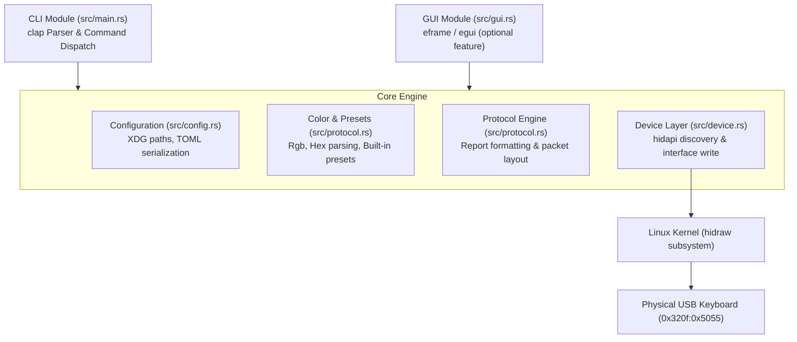

# System Architecture: `kreoctl`

This document describes the architectural layout, component responsibilities, and runtime data flow of `kreoctl`.

---

## High-Level Architecture

`kreoctl` separates user interface concerns (CLI, optional GUI) from domain logic (color definitions, configuration persistence) and low-level hardware communication (HID protocol, report serialization, device backends).



---

## Component Responsibilities

### 1. Application Entrypoint (`src/main.rs`)
- Parses command line flags using `clap`.
- Dispatches execution to presets, autostart, color setting, or graphical interface.
- Returns explicit POSIX exit codes (`std::process::ExitCode::SUCCESS` / `FAILURE`).
- Provides clean fallbacks when GUI features are omitted at compile time.

### 2. Device Communication (`src/device.rs`)
- Discovers attached USB devices using `hidapi`.
- Validates Vendor ID (`0x320f`) and Product ID (`0x5055`).
- Verifies interface numbers and report capabilities before issuing write calls.
- Emits contextual diagnostics when devices are missing or unreadable due to permissions.

### 3. Protocol Engine (`src/protocol.rs`)
- Translates high-level color representations (`Rgb`) into byte-exact 64-byte USB Output Reports.
- Isolates reverse-engineered magic bytes and packet headers from application code.
- Operates entirely in userspace without dependencies on hardware handles, enabling fast in-memory unit tests.

### 4. Configuration Persistence (`src/config.rs`)
- Manages application settings across reboots.
- Adheres to the XDG Base Directory specification via `directories::ProjectDirs` (`$XDG_CONFIG_HOME/kreoctl/config.toml`).
- Generates XDG-compliant `.desktop` autostart files for desktop session initialization.

### 5. Graphical Interface (`src/gui.rs`)
- Rendered using immediate-mode GUI (`egui`/`eframe`).
- Gated behind `#[cfg(feature = "gui")]` to avoid compiling massive windowing and rendering stacks for server or CLI-only installations.
- Communicates with hardware exclusively through the shared device and protocol modules.

---

## Data Flow Diagram: Color Application

```mermaid
sequenceDiagram
    autonumber
    actor User
    participant CLI as CLI / GUI
    participant Protocol as Protocol Engine
    participant Device as Device Layer
    participant Config as Config Store
    participant Keyboard as Kreo Hive USB

    User->>CLI: Apply color (e.g. #00ff88)
    CLI->>Protocol: parse_color("#00ff88")
    Protocol-->>CLI: Rgb { r: 0, g: 255, b: 136 }
    CLI->>Protocol: color_report(rgb)
    Protocol-->>CLI: [u8; 64] output report
    CLI->>Device: set_color(rgb)
    Device->>Keyboard: hid_write([u8; 64]) via hidraw
    Keyboard-->>Device: 64 bytes written
    Device-->>CLI: Ok(())
    CLI->>Config: save_last_color(rgb)
    Config-->>CLI: Ok(())
    CLI-->>User: "Applied #00ff88"
```

---

## Safety Guarantees & Invariants

1. **Strict Device Matching:** Packets are never emitted to an open handle unless its VID and PID match `0x320f:0x5055`.
2. **Buffer Length Validation:** Reports are strictly sized at 64 bytes (the known descriptor length for vendor report ID `0x04`).
3. **No Unsafe Code:** The application is written in 100% safe Rust, relying on the memory safety guarantees of `hidapi` wrappers and Rust standard library constructs.

