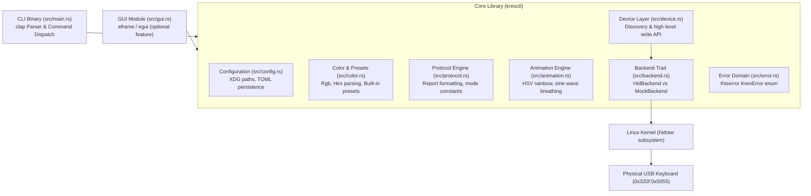

# System Architecture: `kreoctl`

This document describes the architectural layout, component responsibilities, and runtime data flow of `kreoctl`.

---

## High-Level Architecture

`kreoctl` separates user interface concerns (CLI, optional GUI) from domain logic (color definitions, configuration persistence) and low-level hardware communication (HID protocol, report serialization, device backends).



---

## Component Responsibilities

### 1. Application Entrypoint (`src/main.rs`)
- Parses command line flags using `clap`.
- Dispatches execution to presets, autostart, color/mode setting, software animation streaming, or graphical interface.
- Returns explicit POSIX exit codes (`std::process::ExitCode::SUCCESS` / `FAILURE`).
- Provides clean fallbacks when GUI features are omitted at compile time.

### 2. Device Abstraction & Backends (`src/backend.rs` & `src/device.rs`)
- **`DeviceBackend` Trait:** Defines the standard interface for transmitting 64-byte USB Output Reports.
- **`HidBackend`:** Production implementation interacting with `/dev/hidraw*` via `hidapi`.
- **`MockBackend`:** In-memory test fixture recording sent packets and simulating transport failures without physical hardware.
- Emits contextual diagnostics with actionable troubleshooting advice when devices are missing or unreadable.

### 3. Protocol Engine (`src/protocol.rs`)
- Translates high-level `LightingConfig` (mode, color, brightness, speed) into byte-exact 64-byte USB Output Reports.
- Eliminates magic numbers by declaring self-documenting byte offsets and hardware identifiers.
- Operates entirely in userspace without hardware handles, enabling fast deterministic testing.

### 4. Dynamic Animation Engine (`src/animation.rs`)
- Mathematical color wave calculation (HSV rainbow spectrum generation, sine-wave breathing intensity).
- Frame pacing controlled by speed levels (1..5) with zero CPU overhead.
- Supports graceful, non-blocking cancellation via `AtomicBool`.

### 5. Configuration Persistence (`src/config.rs`)
- Manages application settings across reboots (last applied color, mode, brightness, speed).
- Adheres to the XDG Base Directory specification via `directories::ProjectDirs` (`$XDG_CONFIG_HOME/kreoctl/config.toml`).
- Generates XDG-compliant `.desktop` autostart files for desktop session initialization.

### 6. Graphical Interface (`src/gui.rs`)
- Rendered using immediate-mode GUI (`egui`/`eframe`).
- Gated behind `#[cfg(feature = "gui")]` to avoid compiling massive windowing stacks for server or CLI-only installations.
- Communicates with hardware exclusively through the shared device and protocol modules.

---

## Data Flow Diagram: Color & Mode Application

```mermaid
sequenceDiagram
    autonumber
    actor User
    participant CLI as CLI / GUI
    participant Protocol as Protocol Engine
    participant Device as Device Layer
    participant Backend as DeviceBackend (HID)
    participant Config as Config Store
    participant Keyboard as Kreo Hive USB

    User->>CLI: Apply color & mode (e.g. --mode breathing #00ff88)
    CLI->>Protocol: parse_color("#00ff88")
    Protocol-->>CLI: Rgb { r: 0, g: 255, b: 136 }
    CLI->>Protocol: build_report(LightingConfig)
    Protocol-->>CLI: [u8; 64] output report
    CLI->>Device: set_lighting(LightingConfig)
    Device->>Backend: write_report([u8; 64])
    Backend->>Keyboard: hid_write([u8; 64]) via hidraw
    Keyboard-->>Backend: 64 bytes written
    Backend-->>Device: Ok(())
    Device-->>CLI: Ok(())
    CLI->>Config: save_last_lighting(LightingConfig)
    Config-->>CLI: Ok(())
    CLI-->>User: "Applied #00ff88 (Mode: Breathing, Brightness: 4, Speed: 3)"
```

---

## Safety Guarantees & Invariants

1. **Strict Device Matching:** Packets are never emitted to an open handle unless its VID and PID match `0x320f:0x5055`.
2. **Buffer Length Validation:** Reports are strictly sized at 64 bytes (`REPORT_LEN`), matching the verified descriptor length for vendor report ID `0x04`.
3. **100% Safe Rust:** The entire codebase is written in safe Rust (`#![forbid(unsafe_code)]` compatible), relying solely on memory safety and standard library abstractions.
4. **Deterministic Testing:** All core protocol logic, report serialization, and animation generation are tested against `MockBackend` without requiring real USB devices.
