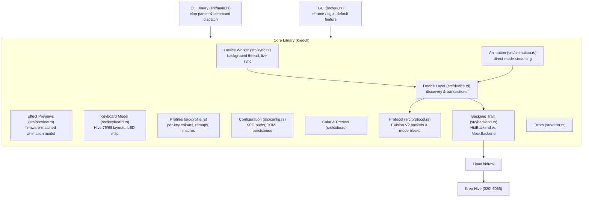
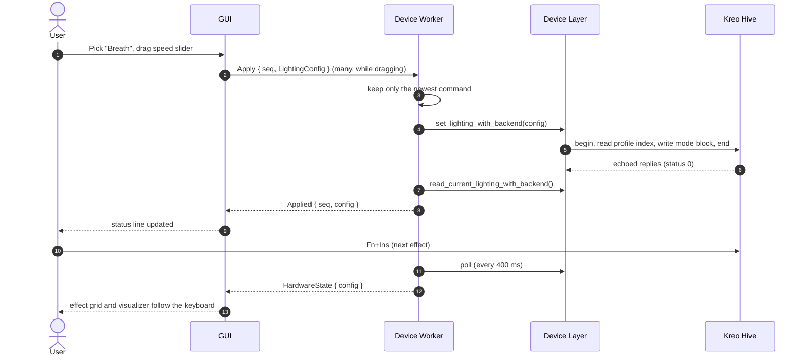

# System Architecture: `kreoctl`

This document describes the layout, component responsibilities, and runtime data flow of `kreoctl`.

---

## High-Level Architecture

`kreoctl` separates the user interfaces (CLI and GUI) from domain logic (lighting model, keyboard layouts, profiles, effect previews) and from hardware communication (EVision V2 protocol, device transactions, HID backends).

---

## Component Responsibilities

### 1. Application Entrypoint (`src/main.rs`)
- Parses flags with `clap`: colours, effects, brightness, speed, direction, `--status`, `--probe-led`, `--stream`, `--restore`, autostart, and `--gui`.
- Starts from the last saved lighting so a single flag changes only that value.
- Prints `udev` troubleshooting advice when the keyboard cannot be opened.

### 2. Protocol (`src/protocol.rs`)
- Builds checksummed 64-byte EVision V2 reports (command, address, payload) and validates the keyboard's echoed replies.
- Models all firmware effects (`LightingMode`) and what each supports: colour, random colours, speed, direction axis.
- Encodes and decodes the 18-byte per-profile mode block. See `docs/HARDWARE_PROTOCOL.md`.
- Pure functions, testable without hardware.

### 3. Device Layer & Backends (`src/device.rs`, `src/backend.rs`)
- Detects the Hive 75 / 65 and opens the vendor lighting interface (Usage Page `0xFF1C`).
- Runs request/reply transactions: begin/end framing, chunked reads and writes, repairing a corrupt profile index.
- Writes and reads the active profile's lighting, uploads per-key colours to custom colour memory, and streams direct-mode frames.
- `DeviceBackend` abstracts the transport; `MockBackend` echoes requests or replays queued replies for tests.

### 4. Keyboard Model (`src/keyboard.rs`)
- Key layouts for the Hive 75 (verified) and Hive 65 (experimental), with selection helpers.
- Maps key codes to LED slots (`slot = column * 8 + row`, verified on a Hive 75) and builds the per-key colour buffer.

### 5. Device Worker (`src/sync.rs`)
- Owns one HID handle on a background thread so the GUI never blocks on USB.
- Collapses bursts of commands (slider drags) into one write and tags them with sequence numbers.
- Polls the keyboard every 400 ms and reports changes made on the device itself (Fn+Ins, Fn+arrows).

### 6. Profiles & Configuration (`src/profile.rs`, `src/config.rs`)
- Profiles hold the lighting state, per-key colours, key remaps and macros.
- Settings and profiles are stored as TOML at `$XDG_CONFIG_HOME/kreoctl/config.toml`; autostart uses an XDG `.desktop` file.

### 7. Effect Previews & Animation (`src/preview.rs`, `src/animation.rs`)
- `preview` reproduces each firmware effect's shape, direction and pace (measured on a Hive 75) for the on-screen visualizer.
- `animation` provides colour helpers and streams software animations to the keyboard in direct mode.

### 8. Graphical Interface (`src/gui.rs`)
- Immediate-mode UI with `egui`/`eframe`, built by default (`--no-default-features` gives a CLI-only binary).
- Light Setting: effect grid, brightness/speed/direction, colours, an animated keyboard visualizer, per-key painting and live sync status.
- Button Settings and Macro Management tabs edit the active profile.
- Sends every hardware change through the device worker.

---

## Data Flow: Applying an Effect from the GUI

---

## Invariants

1. **Strict device matching:** reports are only sent to the known Kreo VID/PID pairs, on the vendor lighting interface.
2. **Validated replies:** every request waits for the keyboard's echo and checks command, address, checksum and status.
3. **No writes on startup:** the GUI only reads the keyboard until the user changes something.
4. **Deterministic tests:** protocol, device transactions, LED map and effect previews are tested against `MockBackend` and pure functions, without hardware.
5. **Minimal `unsafe`:** limited to glibc memory tuning (`mallopt`, `malloc_trim`) on Linux.
